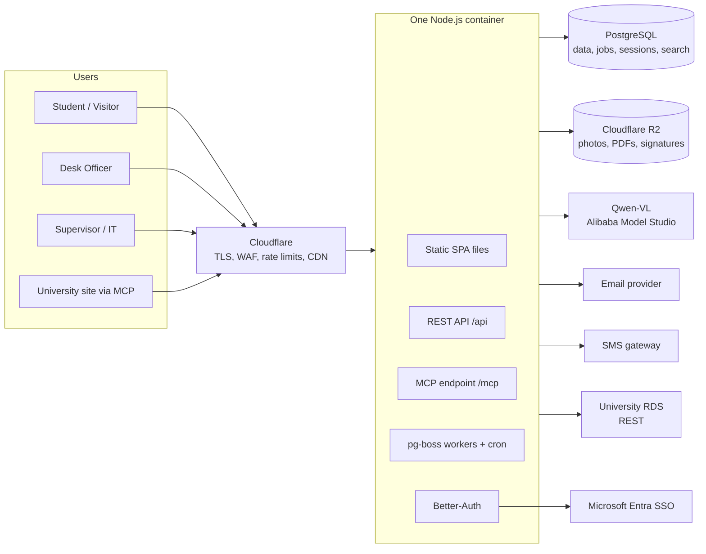

# Campus Lost & Found Portal: Architecture and Build Plan

Version 0.2 · 8 Nov 2026 · Replaces v0.1 · Based on SRS excerpt v0.1, the Figma board, your answers, and the architecture review

---

## 0. What changed from v0.1

v0.1 was sized for a much busier system than this one. Realistic load is 20–50 items logged a day and under 1 request per second almost all the time, even in semester-start peaks. v0.2 keeps the domain rules and security goals but cuts the moving parts down to **one app container, one Postgres database and one object store**.

### Your answers and what they changed

| Question | Answer | Effect on the plan |
|---|---|---|
| Who builds it | Mostly AI agents, with a person overseeing | Fewer runtimes and one language. Strict conventions, tests as the spec, and a short list of modules a human must review (section 10). |
| Qwen-VL | Alibaba Cloud API now, self-hosted later | Called directly from Node through an OpenAI-compatible client. Switching to self-hosted later is a base-URL change (section 7). |
| Data residency | No restriction | Host in Singapore for low latency from Dhaka. |
| RDS integration | REST API | A small HTTP adapter with retries and a short cache (section 8). |
| Budget | Demo; a few instances billed hourly is fine | I read this as "small fixed cost is fine, no need for enterprise setup yet". Section 9 targets a few tens of dollars a month. Tell me if you meant something else. |
| Proxy pickup (A6) | Allowed | Proxy nomination ships in the claim flow, default on in policies. |
| FR-20 | Leave it | Dropped. Sensitive items follow CC-06 and NF-02 as written. |

### Review points: what I adopted, adjusted or pushed back on

| Review point | Decision | Notes |
|---|---|---|
| Too many runtimes (web, api, worker, vision, mcp) | **Adopted** | One Node process serves the SPA, the REST API, background jobs and the MCP endpoint. Same image can run a second copy later if needed. |
| Keycloak is heavy and lacks native SMS/email OTP | **Adopted** | Replaced with Better-Auth inside the app (Entra OIDC, email OTP, phone OTP plugins). |
| Outbox + Redis + BullMQ is double counting | **Adopted** | pg-boss on Postgres. Jobs are inserted in the same transaction as the state change, so the outbox table and Redis both go. |
| RLS + connection pooling risk | **Adopted, with a change** | No RLS and no pooler for v1. `tenant_id` stays on every table and is enforced by one query helper plus a test. RLS is added when a second university signs up. |
| Python vision sidecar | **Adopted** | Removed. `sharp` in Node handles EXIF stripping and resizing. Qwen-VL is called directly. |
| Hash-chained audit log locks on every write | **Adopted** | Plain append-only inserts. An hourly job writes a hash checkpoint over new rows. |
| Drafts auto-saved to the server | **Adopted conclusion, not the reasoning** | At 50 items a day, server drafts would not bloat Postgres. But local drafts are simpler and work offline, so drafts move to the browser. |
| CLIP as a privacy gate is brittle | **Adopted** | CLIP is removed. The gate is now a one-tap user answer plus a second check by the model (section 7.3). Residual risk is stated, not hidden. |
| Next.js proxying to a separate NestJS server | **Adopted** | Vite + React SPA, served as static files by the same Node app. No SSR needed for a mostly signed-in app. |
| Use tRPC inside Next.js | **Not adopted** | You need REST anyway for RDS and a clear API for MCP. tRPC would mean maintaining two API styles. |
| Switch to Gemini / Bedrock for the VLM | **Not adopted** | You have chosen Qwen-VL. Keeping the provider behind one interface means trying Gemini or Bedrock later is a config change. Vendor no-training terms reduce the risk but the photo still leaves your system, so the privacy gate stays either way. |
| Drop pgvector for v1 | **Adopted** | Matching uses structured fields the model extracts (category, colour, brand, material, visible text) plus `pg_trgm`. |
| Drop KMS, use app-level AES-256-GCM | **Adopted** | With a key version column so keys can be rotated. |
| Cloudflare in front, R2 for storage | **Adopted** | Free WAF, rate limiting and CDN. No egress fees on gallery images. |
| "95% accuracy on day 1" | **Will measure, not assume** | Agents build a small evaluation script against 100 real campus photos before the feature is switched on (section 7.5). |

---

## 1. Stack

| Layer | Choice | Why |
|---|---|---|
| Server | **NestJS** on Node.js 22, TypeScript | Enforced module structure. That matters more than usual when AI agents write most of the code: every feature lands in the same shape, which makes review faster. |
| Frontend | **Vite + React SPA**, TanStack Router, TanStack Query, React Hook Form, Tailwind, Radix UI | Built once, served as static files. Radix gives accessible dialogs, tabs and menus for WCAG 2.1 AA. Installable PWA with `vite-plugin-pwa`. |
| Shared types | **Zod** schemas in a `contracts` package | Same schema validates the form, the REST endpoint and the MCP tool input. OpenAPI generated from them. |
| Database | **PostgreSQL 16** (managed) | All data, the job queue, full-text search and `pg_trgm`. |
| ORM / SQL | **Drizzle** | Typed SQL, readable migrations, easy to drop to raw SQL for triggers. |
| Jobs and timers | **pg-boss** | Postgres-backed queue and cron. Runs inside the app process. |
| Auth | **Better-Auth** | In-process, stores sessions in Postgres. Microsoft Entra (OIDC), email OTP, phone OTP. |
| Files | **Cloudflare R2** (S3-compatible API) | Photos, signatures, label PDFs, exports. Browser uploads with short-lived signed URLs. |
| Images | **sharp** | Strip EXIF/GPS, resize, convert to WebP under 500 KB. |
| Vision | **Qwen-VL via Alibaba Cloud Model Studio**, OpenAI-compatible endpoint | One call returns structured JSON. Later: same client pointed at your own vLLM server. |
| Email | Resend, Postmark or Amazon SES behind one adapter | Whichever is quickest to verify a sending domain with. |
| SMS (P1) | Local Bangladeshi SMS gateway behind an adapter | Only needed for visitor phone OTP and P1 alerts. |
| PDFs | `pdf-lib` | Avery L7165 label sheets, DSP exports. |
| MCP (later) | Official MCP TypeScript SDK, Streamable HTTP | Mounted at `/mcp` in the same app. |
| Edge | **Cloudflare** | TLS, WAF, rate limits on OTP routes, CDN for the SPA and images. |
| Errors and logs | Sentry free tier + structured JSON logs | Enough for a demo. Add OpenTelemetry later. |

---

## 2. Architecture



One container image. Environment flags decide what it runs (`RUN_WEB`, `RUN_JOBS`), all on by default. If jobs ever slow down requests, run a second copy of the same image with only `RUN_JOBS=true`. That is a deploy setting, not a new codebase.

### 2.1 Modules inside the server

Each module owns its tables and talks to others through their services.

| Module | Owns | SRS refs |
|---|---|---|
| `identity` | users, roles, staff, visitors, proxy nominations | A2, roles, CC-09, CC-10 |
| `catalog` | buildings, floors, zones, desks, bins, categories, colours, policies | FR-04 |
| `items` | found items, lost reports, photos, private details, state machines | FR-03 to FR-06 |
| `matching` | scores, reasons, "this might be theirs" pings | FR-07, NF-01 |
| `claims` | claims, generated questions, answers, reviews | FR-11, FR-12, NF-03, CC-01, CC-15 |
| `custody` | intake, bins, labels, shelf checks, outage label sheets | FR-13, FR-15, NF-04 |
| `dispatch` | pickup codes, handovers, signatures, DSP records, amendments, disputes | FR-16 to FR-18, WF-04, WF-06 |
| `retention` | expiry, last-chance alerts, disposal decisions, holiday calendar | WF-05, NF-09 |
| `notifications` | in-app alerts, email, SMS | FR-09, US-04, US-09 |
| `audit` | append-only events and hourly checkpoints | FR-14 |
| `reports` | hotspots, KPIs, CSV/PDF export | NF-07, FR-18 |
| `ai-assist` | photo analysis and stored suggestions | photo-to-description |
| `migration` | paper register import | WF-07, NF-05 |
| `integrations` | RDS client, MCP tools, webhooks | section 8 |

### 2.2 Code rules

1. **One way to change state.** `transition(record, event, actor, note)` checks the transition table and the actor's role, updates the row, inserts the audit event and enqueues any follow-up jobs, all in one transaction. pg-boss accepts the open transaction, so a job exists only if the change committed.
2. **Injectable clock.** All time logic reads from a `Clock` service. Staging lets you jump time with the prototype toolbar.
3. **Working-day calendar.** Sun to Thu, plus a holiday table. Used for pickup windows, claim targets and holiday pause.
4. **Tenant filter in one place.** Every query goes through a repository helper that adds `tenant_id`. A test fails the build if any query on a tenant table skips it.
5. **Shared Zod contracts** for every request, response and MCP tool.

---

## 3. Data

### 3.1 Tables (trimmed from v0.1)

```
tenants               id, slug, name, theme, timezone, working_days, settings(jsonb)
users / sessions / accounts / verifications   -- managed by Better-Auth
role_assignments      user_id, role, desk_id
buildings, floors, zones, desks, bins
found_items           id(FND…), tenant_id, state, category, colour, brand, material, short_name,
                      public_desc, visible_text_tags, building/floor/zone, found_from, found_to,
                      bin_id, source, sensitive, high_value, retention_ends_at, search_tsv
lost_reports          id(LST…), tenant_id, owner_id, state, same descriptive fields,
                      time_from, time_to, expires_at, renew_count
item_photos           id, record_id, key, kind(public|condition|proof), hidden, sha256
private_details       record_id, ticks(jsonb), note_ciphertext, key_version
matches               found_id, lost_id, score, reasons(jsonb), notified_at
claims, claim_reviews, pickups(code_hash, window_ends_at, attempts, proxy_user_id)
dispatches            id(DSP…), found_id, claim_id, officer_id, recipient_id, proxy_id,
                      id_check, second_check, signature_key, signed_hash, created_at, locked_at
amendments, disputes
audit_events          id(bigserial), tenant_id, record_type, record_id, actor_id,
                      from_state, to_state, note, at                    -- insert-only
audit_checkpoints     id, from_event_id, to_event_id, hash, created_at  -- hourly
id_counters, reserved_label_ranges
ai_suggestions        id, photo_id, model, output(jsonb), accepted_fields, edited_fields
pgboss.*              -- created by pg-boss
```

Removed from v0.1: `outbox`, `image_embedding`, KMS key IDs, `prev_hash` on every audit row, server-side drafts.

### 3.2 Identifiers

Unchanged: `<TYPE>-<YYMM>-<SEQ><CHECK>`, sequence from a locked counter row, check letter validated before searching, outage sheets reserve ranges, merged IDs redirect.

### 3.3 Audit without lock contention

1. `audit_events` is insert-only: the app's DB role has INSERT and SELECT only, and a trigger rejects UPDATE and DELETE.
2. An hourly pg-boss cron reads new events in ID order, hashes them together with the previous checkpoint's hash, and writes one `audit_checkpoints` row. Editing any old event breaks the next checkpoint.
3. The 10-minute undo is a new compensating event, never a delete.

### 3.4 Search and matching

- `tsvector` over name, brand, description, visible text tags and ID, plus `pg_trgm` for typos. Fine far beyond 50k rows.
- Matching runs as a pg-boss job when a found item or lost report is created or changes state. Hard filter on category and overlapping time, then a weighted score on colour, brand, material, keywords, building and zone. Reasons are stored for display.

---

## 4. Security

| Area | v0.2 approach |
|---|---|
| Transport | Cloudflare TLS to users, Full (strict) TLS to the origin, HSTS. Origin only accepts Cloudflare IPs. |
| Rate limiting | Cloudflare rules on `/api/auth/*` and OTP routes, plus per-account limits in Better-Auth. |
| Sign-in | Students and staff: Entra SSO, email OTP fallback. Visitors: phone OTP. Staff roles: SSO only. OTP 6 digits, 5-minute expiry, 5 attempts. |
| Sessions | HttpOnly, Secure, SameSite=Lax cookies. Nothing in localStorage except drafts. |
| Authorisation | NestJS guards for roles, service-level checks for record rules (visitors can't browse, IT admin can't decide claims, private details only for desk staff during review, pings never reveal names). |
| Private details | AES-256-GCM in the app with Node `crypto`. Key from a secret env var, `key_version` stored per row for rotation. |
| ID and card numbers | Keyed hash for matching, last 4 digits for display. |
| Photos | `sharp` strips metadata and re-encodes every upload. Sensitive photos stored hidden and served only to staff via short-lived signed URLs. |
| Pickup codes | Stored hashed, attempt limit, expire with the pickup window. |
| Audit | Insert-only table plus hourly checkpoints. DSP records lock after 24 h. |
| Secrets | Platform secret store. AI agents never see production secrets. |
| Checks | Dependency and secret scanning in CI. OWASP ASVS Level 2 checklist before going beyond the demo. |

---

## 5. Frontend

```
apps/web/src/
  routes/
    auth/              sign-in, visitor
    student/           home, gallery, activity, alerts, report-lost, report-found, item, claim
    desk/              home, log, hand-back, claims, find, more, practice
    supervisor/        overview, approvals, retention, dispatch, disputes, flags, reports,
                       register, policies, staff
    admin/             integrations, backups, roles
  features/            one folder per flow: steps, hooks, API calls
  components/          ItemCard, AlertCard, TodayList, Stepper, PickupCode, BinLabel
packages/ui/           tokens + Button, Badge, Notice, Input, CategoryTile, ColourChip,
                       Modal, BottomSheet
```

- **Drafts:** text fields in localStorage, photo blobs in IndexedDB, keyed by user and form. Cleared on submit.
- **Speed on slow mobile (NFR-02):** route-level code splitting, PWA caching of the app shell and catalog data, WebP thumbnails from the CDN.
- **Tokens:** export Figma variables (four themes, light and dark) to JSON and generate CSS variables.
- **Labels:** server-generated PDFs so they print the same everywhere.

---

## 6. Design changes (carried over from v0.1, one updated)

1. **Photo first in both report flows**, with a "Skip, I'll describe it" link. **Updated:** before the photo, one large two-button question: "Is it an ID card, bank card, cash or a document?" Yes sends the user to the sensitive lane (no AI, photo hidden). See 7.3.
2. **"Suggested" state** for Category tile, Colour chip and Input, with an "Accept all" button.
3. **"Looking at your photo…" notice** while analysis runs. The rest of the form stays usable.
4. **Office location mismatch.** Home says Admin Building, Security Room. Desk and QR screens say Library, LIB-012. Pick one; it will come from tenant settings.
5. **"Claims Resolved within 30 mins!"** on sign-in conflicts with the 2-working-day target. Change or remove.
6. **Found flow on mobile:** use the 4-step stepper and show live matches as a sticky bar that opens a bottom sheet. Keep the single page on desktop.
7. **Visitor home** without "Recently handed in" and "Browse all".
8. **Global "Scan QR" button** in the desk header.
9. **High-value second check** branch in hand-back (device unlock, serial/IMEI, ask supervisor, cash recount).
10. **Practice mode banner** on every desk screen.
11. **Phone layouts** for the four main student screens at 360 px.
12. **Contrast check** on muted text in all four themes.
13. **Prototype toolbar** kept for staging only, wired to the injectable clock.

---

## 7. AI photo assist

### 7.1 Flow

1. User answers the sensitive-item question. If yes, skip to the sensitive lane.
2. Browser resizes the photo and uploads it to R2 with a signed URL.
3. API enqueues an `analyse-photo` job and returns a job ID.
4. Job: `sharp` strips metadata and resizes to 768 px, then calls Qwen-VL with the image and a prompt that asks for JSON only.
5. Output is validated against a Zod schema. Category and colour must be from your lists; anything else is dropped.
6. Browser polls the job (every 1 s, up to 10 s) and shows suggestions. On timeout the form just works without them.

### 7.2 Output schema

```ts
const PhotoSuggestion = z.object({
  looks_sensitive: z.boolean(),            // ID, bank card, cash, document, passport
  category: z.enum(CATEGORIES).nullable(),
  colour: z.enum(COLOURS).nullable(),
  brand: z.string().max(40).nullable(),
  material: z.string().max(30).nullable(),
  short_name: z.string().max(60),
  public_description: z.string().max(200),
  suggested_private_ticks: z.array(z.enum(PRIVATE_TICKS)),
  confidence: z.number().min(0).max(1),
});
```

### 7.3 Privacy gate (replaces CLIP)

Three layers, none of them perfect alone:

1. **User answer first.** The one-tap question in 6.1 catches the obvious cases before any upload.
2. **Model second check.** If the model returns `looks_sensitive: true`, the server hides the photo, discards the description, sets the item as sensitive and tells the user. The photo has already been sent once in this case.
3. **Text scrub.** Any long digit runs, emails or names are removed from `public_description` before it reaches the form. Serial numbers never go into public fields.

**Residual risk, stated plainly:** a user who answers "no" for an ID card will have that one photo sent to Alibaba's API. For a demo with test data this is acceptable. Before real students use it, either self-host Qwen-VL (your stated plan, which removes the third party entirely) or confirm Alibaba Model Studio's data-retention terms in writing. I haven't verified those terms.

### 7.4 Provider adapter

```ts
interface VisionProvider { analyse(image: Buffer, locale: 'en'): Promise<PhotoSuggestion> }
```

- `QwenModelStudioProvider`: Alibaba's OpenAI-compatible endpoint with your API key.
- `SelfHostedQwenProvider`: the same OpenAI client pointed at your own vLLM server later. Same prompt, same schema.
- Provider and model name come from config. Pick the current Qwen-VL model on Model Studio when you set it up.

Cost controls: 768 px images, cache by image SHA-256, per-user limit (for example 20 analyses an hour), 10 s timeout.

### 7.5 Measure before switching it on

Agents build `scripts/eval-vision.ts`: run 100 labelled campus photos (bottles, bags, phones, IDs, cash, chargers, umbrellas) through the provider and report category accuracy, colour accuracy, and how many sensitive photos were flagged. Gate: sensitive recall must be 100% on the test set, category accuracy above an agreed bar. Re-run whenever the model or prompt changes. `ai_suggestions` keeps recording accept/edit data, so you can compare with your own model later.

The same pipeline runs on the desk "Log a found item" flow (NF-08).

---

## 8. Integrations

### 8.1 RDS (REST)

- `RdsClient` with a 5 s timeout, 2 retries, and a 15-minute cache.
- Used for: university ID number → email (ID card fast lane, US-09) and name/photo lookup at handover.
- Only the hash of the ID number is stored. If RDS is down, the desk can still log the card; the email goes out when a retry job succeeds.

### 8.2 MCP (later phase, same process)

- Mounted at `/mcp`, Streamable HTTP, OAuth with scoped tokens for integration clients.
- Tools: `search_found_items` (public fields only), `get_my_reports`, `create_lost_report` (creates a draft the user confirms), `get_office_info`, `lookup_dispatch` (supervisor only).
- Tool inputs and outputs reuse the Zod contracts, so tools can't drift from the REST API.

### 8.3 Webhooks

Signed webhooks for `item.dispatched` and `report.matched`, sent by pg-boss jobs with retries.

---

## 9. Hosting for the demo

| Piece | Choice |
|---|---|
| App | One container on a PaaS (Railway or Render) or a single small VM (DigitalOcean or Hetzner) with Docker Compose and Caddy. Pick a Singapore region. |
| Database | Managed Postgres from the same provider, daily backups, plus a weekly `pg_dump` to R2 that you test-restore. |
| Files | Cloudflare R2 |
| Edge | Cloudflare free plan |
| Environments | `staging` (time-travel toolbar on, seeded demo data) and `prod` |

Expect a few tens of dollars a month plus Qwen-VL usage, which at demo volume should be small. Check current prices when you sign up; I haven't verified them. Because everything is one Dockerfile and standard Postgres, moving to AWS or a university server later is a migration, not a redesign.

---

## 10. Working with AI agents

Agents write most of the code, so the plan has to be easy to check rather than easy to write.

1. **`AGENTS.md` / `CLAUDE.md` at the repo root.** Module layout, the code rules in 2.2, naming, how to add an endpoint, how to add a migration, what never to do (raw `Date.now()`, queries without the tenant helper, logging private details).
2. **One issue per SRS story.** Each issue lists the SRS IDs and the acceptance tests to write first. Agents work in small branches; one feature per PR.
3. **CI gates on every PR:** typecheck, lint, unit tests, API tests against a real Postgres in Docker, Playwright for touched flows, migration dry-run, dependency and secret scan.
4. **Human review is required for these paths**, with a CODEOWNERS file: `auth`, `identity`, `crypto`, `audit`, the state-machine tables in `packages/domain`, anything touching private details, claim answers or pickup codes, and DB migrations.
5. **Seed data and practice mode** from day one, so every agent and every demo uses the same realistic sample items.
6. **Decision records.** A short ADR in `docs/adr/` for each choice in this plan, so agents don't quietly reintroduce Redis or a second service.

---

## 11. Repository

```
lost-and-found/
  apps/
    server/        NestJS: REST API, Better-Auth, pg-boss jobs, MCP endpoint, serves web build
    web/           Vite + React SPA
  packages/
    contracts/     Zod schemas, OpenAPI generation
    domain/        state machines, ID generator, working-day calendar, matching score
    ui/            tokens and base components
  scripts/         eval-vision, seed, import-paper-register
  infra/           Dockerfile, docker-compose (local Postgres, MinIO for R2, Mailpit), Caddyfile
  docs/adr/
  AGENTS.md
```

Two apps, one deployable.

---

## 12. Build phases

| Phase | Scope | Done when |
|---|---|---|
| **0. Foundations** | Repo, CI gates, AGENTS.md, Docker setup, Better-Auth (Entra, email OTP, phone OTP), catalog, audit, ID generator, clock, calendar, UI tokens, seed data | All three sign-in methods work in staging. |
| **1. Report and intake** | WF-01, WF-02, WF-03, labels and bins, gallery, search, sensitive lane, ID card fast lane with RDS lookup | A found item goes from student post to IN_CUSTODY with a printed label. |
| **2. AI photo assist** | Provider adapter, privacy gate, suggestion UI, eval script, desk photo intake | Eval gate passes. Moved earlier because it is the demo's headline feature. |
| **3. Match, claim, hand back** | Matching and alerts, claims with hidden-detail questions, side-by-side review, pickup codes, proxy pickup, hand-back with ID and second checks, signature, DSP | WF-04 end to end, including two claimants on one item. |
| **4. Supervisor and timers** | All timers, retention and disposal, dispatch directory and export, disputes, flags, policies, staff, undo, paper register import, outage label sheets | Every corner case CC-01 to CC-17 has a passing test. |
| **5. Demo hardening** | Accessibility audit, practice mode, monitoring, backup restore test, NFR-01 trial with a new officer | A new officer completes intake and handover alone after 15 minutes. |
| **6. Integrations** | MCP endpoint, webhooks, SMS alerts, loss hotspot report | University site can search items and show a student's report status. |

---

## 13. When to add back what was removed

| Add | When |
|---|---|
| Postgres RLS | A second university is onboarded |
| Separate job container (same image) | Jobs measurably slow down API responses |
| Redis | Never needed unless you add real-time features with many concurrent users |
| Image embeddings (pgvector) | Structured matching misses items that look alike, and you have the accept/edit data to prove it |
| Self-hosted Qwen-VL | Before real student photos go through the AI feature |
| AWS / managed enterprise hosting | The university takes it over and has its own requirements |
