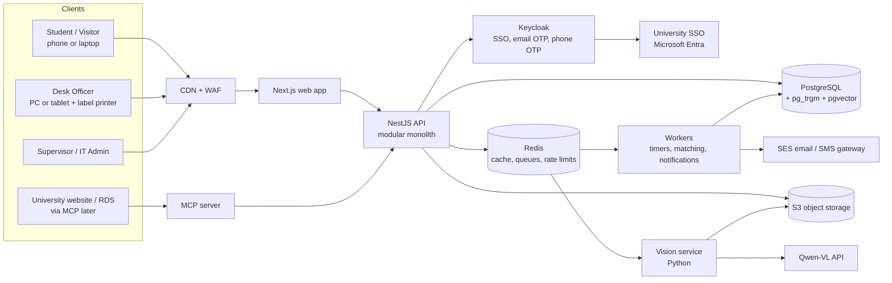
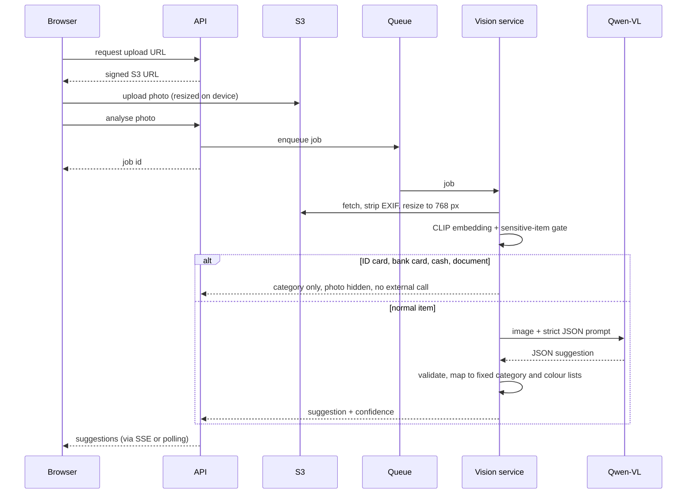

# Campus Lost & Found Portal: Architecture and Build Plan

Version 0.1 · 8 Nov 2026 · Based on SRS excerpt v0.1 and the Figma board "Website Design Lost and Found"

Decisions this plan is built on:

| Question | Answer |
|---|---|
| Tenancy | One university now (NSU). Schema and auth built so more universities can be added later without a rewrite. |
| Hosting | Public cloud. AWS is used in the examples. Everything runs in containers, so moving to GCP or Azure is a config change, not a rewrite. |
| Backend language | No team preference. Recommendation below. |

What I reviewed: the full SRS excerpt, all 49 screens on the Figma Cover page (student, visitor, desk officer, supervisor, IT admin), the Foundations page (four colour themes, light and dark) and the Components page. I did not open the Figma Make code, since you said it is reference only and the stack will change.

---

## 1. The short version

Build a **modular monolith in TypeScript** with a **small Python service for vision**. One API serves the web app, the background workers and, later, the MCP server.

| Layer | Choice | Why |
|---|---|---|
| Web app | Next.js (React, App Router) + Tailwind + Radix UI primitives | Server rendering keeps pages under 3 s on slow mobile (NFR-02). Radix gives accessible dialogs, menus and tabs for WCAG 2.1 AA. Works as an installable PWA on Android. |
| API | NestJS (Node.js, TypeScript) | Clear module boundaries, dependency injection, guards for role checks, first-class OpenAPI output. One language with the frontend means shared types and validation. |
| Background jobs | BullMQ workers (Node.js) on Redis | Timers the SRS depends on: 24 h reminder, 48 h NOT_RECEIVED, daily retention, pickup window lapse, 30-day report expiry. |
| Vision service | Python FastAPI | YOLO, CLIP and most vision tooling are Python-first. Kept small and separate so it can scale or move to GPU on its own. |
| Database | PostgreSQL 16 | Relational data with strict state rules. Full-text search plus `pg_trgm` covers "search under 1 s across 50k records" without a separate search engine. `pgvector` handles image similarity (FR-08) later. Row-Level Security makes multi-tenancy safe. |
| Cache, queues, rate limits | Redis | One component for three jobs. |
| File storage | S3 (or any S3-compatible store) + CDN | Photos, signatures, label PDFs, exports. Browser uploads directly with short-lived signed URLs. |
| Identity | Keycloak as an identity broker | Handles university SSO (the design shows Microsoft Entra), email OTP and phone OTP in one place. When a second university joins, you add an identity provider config, not code. |
| Email / SMS | Amazon SES, plus a local Bangladeshi SMS gateway behind an adapter | SMS is P1. The adapter lets you switch gateways. |
| MCP server (later) | Separate small app using the official MCP TypeScript SDK | Thin layer over the same API services. No business logic of its own. |

Why not microservices: the expected load (one campus, tens of thousands of users, peaks of a few hundred requests per second at most) does not need them, and they would make a small team slower. The monolith is split into modules with strict boundaries, so a module can be pulled out later if one really needs to scale on its own. The pieces that do have different scaling needs (workers, vision) are already separate processes.

Why not Python for the whole backend: it is a fair choice and FastAPI would work. TypeScript wins here because the frontend is React, the MCP SDK is strongest in TypeScript, and sharing one set of validation schemas between form, API and MCP tools removes a whole class of bugs. Python stays where it is strongest: the models.

---

## 2. System architecture



### 2.1 Modules inside the API

Each module owns its tables and exposes services to the others. No module reads another module's tables directly.

| Module | Owns | Main SRS refs |
|---|---|---|
| `identity` | users, roles, staff, visitor accounts, proxy nominations | A2, roles, CC-09, CC-10 |
| `catalog` | campus config: buildings, floors, zones, desks, bins, categories, colours, policies | FR-04, Policies screen |
| `items` | found items, lost reports, photos, private details, state machines | FR-03 to FR-06, lifecycles |
| `matching` | match scores and reasons, "this might be theirs" pings | FR-07, FR-08, NF-01 |
| `claims` | claims, generated questions, answers, Pass/Fail reviews | FR-11, FR-12, NF-03, CC-01, CC-15 |
| `custody` | intake, bins, labels, shelf checks, outage label sheets | FR-13, FR-15, NF-04 |
| `dispatch` | pickup codes, handovers, signatures, DSP records, amendments, disputes | FR-16 to FR-18, WF-04, WF-06 |
| `retention` | expiry, last-chance alerts, donate/dispose/transfer decisions, holiday calendar | WF-05, NF-09 |
| `notifications` | in-app alerts, email, SMS, preferences | FR-09, US-04, US-09 |
| `audit` | append-only event log | FR-14 |
| `reports` | hotspots, KPIs, CSV/PDF export | NF-07, FR-18 |
| `ai-assist` | photo analysis requests and stored suggestions | your photo-to-description feature |
| `migration` | paper register import | WF-07, NF-05 |

### 2.2 Rules that keep the code maintainable

1. **State changes go through one place.** Each lifecycle (found item, lost report, claim) is a transition table in code. The only way to change a state is `transition(record, event, actor, note)`. That function checks the transition is allowed, checks the actor's role, writes the new state, writes the audit event and writes an outbox event, all in one database transaction.
2. **Outbox pattern for side effects.** Emails, alerts and matching runs are not sent from inside the request. The transaction writes an `outbox` row, and a worker sends it. If email is down, nothing is lost and the user's action still succeeds.
3. **Injectable clock.** All time logic (48 h hand-in, 3 working days, retention) reads time from a `Clock` service, never `Date.now()` directly. The prototype's "+1 h / +1 day / +1 week" toolbar becomes a real testing tool in staging.
4. **Working-day calendar.** NSU works Sun to Thu. Pickup windows and claim targets are counted in working days from a calendar table that also holds official closures (needed for NF-09 holiday pause).
5. **Shared schemas.** One `contracts` package holds Zod schemas for every request and response. The form, the API and the MCP tools all validate with the same schema.

---

## 3. Data design

### 3.1 Main tables

```
tenants              id, slug, name, theme, timezone, working_days, settings(jsonb)
users                id, tenant_id, kind(student|staff|visitor), email, phone, univ_id_hash, name, photo_key
role_assignments     user_id, role(desk|supervisor|it_admin), desk_id
buildings/floors/zones, desks, bins
found_items          id(FND…), tenant_id, state, category, colour, brand, short_name, public_desc,
                     building/floor/zone, found_from, found_to, bin_id, source(finder|desk|migrated),
                     sensitive(bool), high_value(bool), retention_ends_at, search_tsv, image_embedding(vector)
lost_reports         id(LST…), tenant_id, owner_id, state, same descriptive fields, time_from, time_to,
                     expires_at, renew_count
item_photos          id, item_id|report_id, key, kind(public|condition|proof), hidden(bool), sha256
private_details      record_id, ticks(jsonb), note_ciphertext, data_key_id         -- encrypted, FR-06
matches              found_id, lost_id, score, reasons(jsonb), notified_at
claims               id(CLM…), found_id, claimant_id, state, questions(jsonb), answers_ciphertext
claim_reviews        claim_id, reviewer_id, per_question_result, decision, note
pickups              claim_id, code_hash, window_ends_at, attempts, proxy_user_id
dispatches           id(DSP…), found_id, claim_id, officer_id, recipient_id, proxy_id, id_check,
                     second_check, signature_key, signed_hash, created_at, locked_at
amendments           dispatch_id, reason, diff(jsonb), by, at
disputes             dispatch_id, raised_by, statement, outcome, entries(jsonb)
audit_events         id, tenant_id, record_type, record_id, actor_id, from_state, to_state, note,
                     at, prev_hash, hash                                                 -- append-only
id_counters          tenant_id, type, yymm, next_seq
reserved_label_ranges tenant_id, from_seq, to_seq, printed_at, used(bool[])             -- NF-04
ai_suggestions       id, photo_id, model, output(jsonb), confidence, accepted_fields, edited_fields
outbox               id, topic, payload, created_at, sent_at
```

### 3.2 Identifiers

Format `<TYPE>-<YYMM>-<SEQ><CHECK>`, for example `FND-2611-0042K`.

1. Sequence comes from `id_counters`, locked per `(tenant, type, yymm)` row inside the transaction. No gaps from rollbacks matter because IDs are never reused.
2. The check letter is computed with a mod-23 or Luhn mod-N scheme over the digits. Search accepts `fnd26110042k`, strips dashes, upper-cases and validates the check letter before hitting the database. A wrong check letter returns "That ID has a typo" instead of "not found".
3. Outage sheets (NF-04) reserve a block of sequence numbers in advance. When the desk comes back online, entering an item under a reserved ID keeps the original intake time (CC-17).
4. Merging duplicates (CC-04) keeps both IDs. The old one becomes a redirect, never deleted.

### 3.3 Multi-tenant readiness (cheap now, expensive later)

1. Every table has `tenant_id` from day one, even though there is only one tenant.
2. PostgreSQL Row-Level Security policies filter by `current_setting('app.tenant_id')`, which the API sets at the start of each transaction. A bug in a query cannot leak another university's data.
3. Everything NSU-specific lives in `tenants.settings` and the `catalog` tables: buildings, desk location and hours, retention days, proxy pickup on/off (A6), pickup window, claim cap, theme. Nothing NSU-specific in code.
4. The four colour themes on the Foundations page (Navy, Forest, Indigo, Teal) map directly to per-tenant themes via CSS variables. Keep them.
5. Keycloak gets one realm now. A second university later gets its own identity provider inside it.

### 3.4 Search and matching

- **Search:** a generated `tsvector` column over name, brand, description and ID, plus a trigram index for typos and partial words. Filter by tenant, state and category first, then rank. This stays well under 1 s at 50k rows on a small database instance. Revisit only if you go past several million records.
- **Matching (FR-07):** runs in a worker when a found item enters IN_CUSTODY or REPORTED_BY_FINDER, and when a lost report is created. Hard filter on same category and overlapping time window, then a weighted score from colour, brand, keywords, building and zone. Reasons are stored as a list (`same building`, `same colour`) so the UI shows plain-language reasons.
- **Image similarity (FR-08, P1):** the same CLIP embedding produced for the AI photo feature (section 6) is stored in `pgvector` and added to the score. You get FR-08 almost for free.

---

## 4. Security

### 4.1 Connections and secrets

- TLS 1.2+ everywhere, HSTS on the web domain, TLS between services and to the database.
- WAF in front of the CDN with rate rules for login and OTP endpoints.
- All secrets (DB, SMTP, SMS, Qwen-VL and other model API keys) in AWS Secrets Manager. None in the repo, none in the browser.
- Private networking: database, Redis and the vision service have no public address.

### 4.2 Authentication

| User | Method |
|---|---|
| Students and staff | University SSO (OIDC via Entra), with email OTP as fallback |
| Visitors | Phone OTP |
| Desk, supervisor, IT | SSO only, with MFA enforced by the university's identity provider |

OTPs: 6 digits, 5-minute expiry, max 5 attempts, rate-limited per phone/email and per IP. Sessions use short-lived access tokens and HttpOnly, Secure, SameSite cookies. No tokens in localStorage.

### 4.3 Authorisation

Role checks in API guards, plus record-level rules in services. Examples the SRS requires:

- Visitors cannot call gallery endpoints.
- System Admin has no access to item or claim decisions. Enforced in the API, not just hidden in the UI.
- Private details and claim answers are only returned to desk staff during claim review, and every read is logged.
- A user cannot see the other side's name or contact in a "this might be theirs" ping.

### 4.4 Data protection

- **Private details (FR-06):** encrypted at field level with envelope encryption (AWS KMS key encrypts a data key, data key encrypts the field). A database dump alone does not reveal them.
- **ID and card numbers (CC-06):** store a keyed hash for matching (so a logged ID card can find its owner, US-09) and the last 4 digits for display. Never the full number in plain text.
- **Photos:** EXIF and GPS stripped on the server (FR-05), even if the browser already did it. Re-encoded to WebP at or under 500 KB. Sensitive categories are stored as hidden and only served to staff.
- **Uploads:** content type and size checked, images re-decoded (this kills most malicious files), virus scan on upload.
- **Pickup codes:** stored hashed, 3-working-day expiry, attempt limit at the desk.
- **QR codes:** contain only the record URL and ID, nothing personal.
- **Signatures:** stored as images with a SHA-256 hash written into the DSP record.

### 4.5 Audit and tamper evidence

- `audit_events` is append-only. The application's DB user has INSERT and SELECT only on that table, and a trigger blocks UPDATE and DELETE.
- Each event stores the hash of the previous one, so any later edit to history is detectable.
- DSP records lock 24 h after creation (FR-17). After that, only amendments with a reason.
- The 10-minute undo is a compensating event, not a delete.

### 4.6 Baseline

Follow OWASP ASVS Level 2. Add dependency scanning, container image scanning and a secrets scanner in CI. Run a third-party penetration test before go-live. Check local data-protection rules for student data with the university's legal or IT office before choosing a region; AWS Mumbai (ap-south-1) is the closest region to Dhaka.

---

## 5. Scale and reliability

| Concern | Approach |
|---|---|
| Traffic spikes | Web and API run as stateless containers behind a load balancer and autoscale on CPU and request count. Start with 2 of each in different availability zones. |
| Database | Managed PostgreSQL with Multi-AZ failover, automated backups, point-in-time recovery. Add a read replica for reports and exports when needed. Use a connection pooler (RDS Proxy or PgBouncer). |
| Slow work | Anything over ~200 ms (matching, email, PDF, AI) goes to a queue. The user gets an immediate response. |
| Images | Served from the CDN with signed URLs. The API never streams image bytes. |
| Caching | Catalog data (buildings, categories, policies) cached in Redis and in the browser. Gallery pages cached for a short time. |
| Desk outage | NF-04 paper labels. As an extra, the desk app can be a PWA that queues intake entries in IndexedDB and syncs when the connection returns. |
| Backups | Nightly encrypted backups kept 35 days, as shown on the IT Admin screen. Test a restore every month. |
| Monitoring | OpenTelemetry traces and metrics, structured logs, Sentry for errors, alerts on queue backlog, failed emails and error rate. |
| Load testing | k6 scripts for the busiest paths (sign-in, gallery search, lost report submit) run before each release. |

Infrastructure is written in Terraform. Environments: `dev`, `staging` (with the time-travel toolbar on) and `prod`.

---

## 6. AI photo assist (photo to suggested description)

### 6.1 What it does for the user

The user adds a photo first. Within a few seconds the form fills in suggestions for category, main colour, brand, short name and a public description. Each suggested field shows a small "Suggested" tag. The user confirms or edits. Nothing is submitted automatically.

### 6.2 About the model choices

| Model | Fit for this job |
|---|---|
| **LeNet** | Not suitable. It is a very small network built for handwritten digits. It cannot tell a wallet from a charger in real photos. I'd drop it. |
| **YOLO (v8 / 11)** | Good at finding objects and drawing boxes. The stock model is trained on COCO, which has backpack, umbrella, bottle, cell phone, laptop, book and handbag, but has no wallet, keys, ID card, charger, glasses, watch or calculator. To cover all 21 categories it needs fine-tuning on your own photos. |
| **Qwen-VL** | Best fit for the description. One call can return category, colour, brand, short name and a sentence, as JSON. Slower and costs per call, and the photo leaves your system. |
| **CLIP / SigLIP** (my addition) | Small, runs on CPU, self-hosted. Good for zero-shot category guesses and for a privacy gate. Its embedding also powers image matching (FR-08). |

### 6.3 Recommended pipeline



Key rules:

1. **Privacy gate first.** The local CLIP model checks whether the photo looks like an ID card, bank card, cash or a document. If yes, the photo is never sent to the external model, it is marked hidden, and only the category is suggested. This protects card numbers and personal documents (CC-06, NF-02).
2. **Fixed output.** The model must return JSON matching a schema. Category and colour must be values from your lists. Anything else is dropped. This also blocks text written on an object from steering the output.
3. **Never write private details.** The model may suggest which private-detail tick boxes apply ("stickers visible"), but never writes their content. The public description is checked so that numbers, names or serials it read off the item do not appear.
4. **Provider adapter.** One `VisionProvider` interface with adapters for Qwen-VL, a self-hosted YOLO model and CLIP. You supply API keys through Secrets Manager. Swapping or combining models is a config change.
5. **Cost and speed.** Resize to 768 px before sending. Cache results by image hash. Rate-limit per user. 10-second timeout, after which the form simply works without suggestions.
6. **Learn from corrections.** `ai_suggestions` records what the user accepted and what they changed. After a few months you have a labelled dataset of real campus items to fine-tune YOLO, which can then replace most Qwen-VL calls and cut cost.
7. **Desk use too.** The same pipeline fills NF-08 (photo-assisted intake) on the desk "Log a found item" flow.

---

## 7. MCP server and university integration

Design for this now so the later step is small.

1. **API first.** Every action the UI can take is a documented API endpoint with an OpenAPI spec. The MCP server calls the same service layer.
2. **Service accounts.** Integrations authenticate with OAuth 2.1 client credentials and scoped permissions, never with a staff account.
3. **Suggested MCP tools** (read-heavy, safe by default):

| Tool | Who can use it | Returns |
|---|---|---|
| `search_found_items` | signed-in student | Public fields only. Never sensitive items or private details. |
| `get_my_reports` | the owner | Status of their lost reports and claims |
| `create_lost_report` | the owner | Creates a draft the user confirms in the portal |
| `get_office_info` | anyone | Desk location and hours |
| `lookup_dispatch` | supervisor only | DSP record summary for disputes |

4. **Events out.** The outbox can also publish signed webhooks (`item.dispatched`, `report.matched`) for the university portal or RDS.
5. **RDS lookup in.** The "Student records lookup" integration on the IT Admin screen is an adapter that maps a university ID number to an email for the ID card fast lane (US-09). Cache results briefly, store only the hash of the ID number.

---

## 8. Frontend structure

```
apps/web/
  app/
    (auth)/sign-in, visitor
    (student)/home, gallery, activity, alerts, report/lost, report/found, items/[id], claims/[id]
    (desk)/desk, desk/log, desk/hand-back, desk/claims, desk/find, desk/more, desk/practice
    (supervisor)/overview, approvals, retention, dispatch, disputes, flags, reports, register, policies, staff
    (admin)/integrations, backups, roles
  features/        one folder per flow: form steps, hooks, API calls
  components/      app-level pieces (ItemCard, AlertCard, TodayList, Stepper, PickupCode, BinLabel)
packages/ui/       design tokens and base components (Button, Badge, Notice, Input, CategoryTile, ColourChip, Modal, BottomSheet)
```

- Tokens: export the Figma variables (colour themes, spacing, radius, type) to a JSON file and generate CSS variables from it, so design and code stay in sync.
- Forms: React Hook Form + the shared Zod schemas. Drafts save automatically to the server every few seconds (FR-03), with a local copy as backup.
- Data fetching: TanStack Query for client state, server components for first load.
- Guided desk flows: one route per step, so the browser back button and "Step 2 of 4" stay in sync.
- Printing: label PDFs (Avery L7165, 8 per A4 sheet) are generated on the server so they print the same from any browser. Thermal printing is optional via a print-ready layout.
- Accessibility: automated axe checks in CI, keyboard testing of every flow, 16 px minimum text and 44 px targets as the SRS sets.

---

## 9. Layout and design changes I'd suggest

These come from going through the Figma screens against the SRS.

### 9.1 Needed for the AI feature

1. **Photo first in both report flows.** Right now the lost flow asks for category on step 1 and photos on step 2, and the found flow has photos inside section 2. Move "Add a photo" to the top as step 1, with a clear "Skip, I'll describe it" link. With a photo, steps 1 and 2 mostly fill themselves.
2. **Suggestion styling.** Add a "Suggested" state to Category tile, Colour chip and Input in the component library: a small sparkle icon, a subtle outline, and an "Accept all" button above the fields. Users must be able to see what they chose and what the machine guessed.
3. **Loading state.** A short "Looking at your photo…" notice under the photo, with the rest of the form usable while it runs.

### 9.2 Consistency and correctness

4. **Office location doesn't match across screens.** The Home page footer says "Admin Building, Ground floor, Security Room". The desk header and the "Submit and Get QR" screen say "Library, Room LIB-012". Pick one; in code this will come from tenant settings, so it can only be shown one way.
5. **"Claims Resolved within 30 mins!" on the sign-in page** conflicts with the SRS target of 2 working days for claim review. This will create complaints. Suggest "Most items are back with their owner within days" or remove the claim.
6. **Found flow is one long page, lost flow is four steps.** On desktop the long page works well with the live "Someone lost this?" panel beside it. On a phone it will be a very long scroll and the side panel has nowhere to go. Suggest: keep one page on desktop, but on mobile switch to the same 4-step stepper and show the live matches as a sticky bar ("2 people may have lost this") that opens a bottom sheet.
7. **Visitors and the gallery.** The Home page shows "Recently handed in" with a "Browse all" link. Visitors cannot browse the gallery, so their home needs a different version without it.

### 9.3 Desk and staff screens

8. **Global "Scan QR" button in the desk header.** FR-13 says scanning a QR opens the record. Today scanning only exists inside "Log a found item". Officers will scan labels constantly during shelf checks and pickups.
9. **Second-check step for high-value handovers.** The hand-back flow shows ID check and signature. Add the explicit branch for phones, laptops and cash: device unlock, serial/IMEI match or "Ask supervisor", and the cash recount (CC-07, CC-08).
10. **Practice mode banner.** When practice mode is on, show a fixed coloured banner on every desk screen so no one mistakes sample data for real records.

### 9.4 Mobile and accessibility

11. **Student mobile screens.** The board has desktop student screens; the Tab bar component exists but I didn't find full phone layouts. Most students will report from Android phones, so design the four main student screens at 360 px before building.
12. **Contrast check.** Some small grey text on the dark theme (card subtitles like "GYM · Ground floor · Court") looks close to the WCAG AA limit. Run a contrast check on the muted text token in all four themes.
13. **Prototype toolbar.** Keep "View as" and "+1 h / +1 day / +1 week" as a staging-only tool tied to the injectable clock. It is very useful for testing timers and should never ship to production.

---

## 10. Repository layout

One monorepo (pnpm workspaces + Turborepo).

```
lost-and-found/
  apps/
    web/          Next.js
    api/          NestJS
    worker/       BullMQ workers (timers, matching, notifications, PDFs)
    vision/       Python FastAPI (CLIP gate, YOLO, Qwen-VL adapter)
    mcp/          MCP server (later phase)
  packages/
    contracts/    Zod schemas, generated OpenAPI types
    ui/           tokens + base components
    domain/       state machines, ID generator, working-day calendar (pure TS, heavily tested)
    config/       eslint, tsconfig, prettier
  infra/
    terraform/    VPC, RDS, ElastiCache, S3, CDN, ECS, Secrets, KMS, WAF
    docker/       local docker-compose (Postgres, Redis, MinIO, Keycloak, Mailpit)
  docs/
    adr/          one short decision record per major choice
```

ORM: Drizzle or Kysely is recommended over Prisma here, because Row-Level Security, `pgvector` and append-only triggers need raw SQL control. If your team already knows Prisma well, it can work with a bit more setup.

---

## 11. Build phases

Each phase ends with something usable in staging.

| Phase | Scope | Exit check |
|---|---|---|
| **0. Foundations** | Monorepo, CI/CD, Terraform, local docker setup, Keycloak with SSO + OTP, tenants and catalog tables, design tokens and base components, audit log, ID generator, clock and calendar | A user signs in by SSO, email OTP and phone OTP in staging. |
| **1. Report and intake** | Lost report flow (WF-01), found report flow (WF-02), desk "Log a found item" (WF-03), labels and bins, gallery, search, sensitive item rules, ID card fast lane | A found item goes from student post to IN_CUSTODY with a printed label. |
| **2. Match, claim, hand back** | Matching and alerts, claims with hidden-detail questions, side-by-side review, pickup codes, hand-back with ID check and signature, DSP records, finder notification | Full WF-04 end to end, including two claimants on one item. |
| **3. Supervisor and timers** | All timers (24 h, 48 h, expiry, pickup lapse), retention and disposal, dispatch directory with export, disputes, flags, policies, staff, undo, paper register import, outage label sheets | Every corner case CC-01 to CC-17 has a passing test. |
| **4. AI photo assist** | Vision service, privacy gate, Qwen-VL adapter, suggestion UI, desk photo intake (NF-08), image similarity in matching (FR-08) | 90% of non-sensitive test photos get the right category suggestion; zero sensitive photos sent out. |
| **5. Hardening and launch** | Load tests, penetration test, accessibility audit, practice mode, staff training, data migration from paper, monitoring and runbooks | NFR-01 trial: a new officer completes intake and handover alone after a 15-minute session. |
| **6. Integrations** | MCP server, webhooks, RDS lookup, SMS alerts, loss hotspot report | University portal can search items and show a student's report status. |

You could pull the AI phase earlier if it matters for a demo, since the report forms work with or without it.

### Testing approach

- Unit tests on `packages/domain`: every allowed and forbidden state transition, ID check letters, working-day maths.
- API integration tests against a real PostgreSQL in Docker, including RLS (a query for tenant A must never return tenant B rows).
- Playwright end-to-end tests for the main flows, run with the injectable clock to jump time.
- Contract tests on the vision service with a fixed set of sample photos.

---

## 12. Open questions for you

These change parts of the plan, so I'd rather ask than guess:

1. How many developers will build this, and how comfortable are they with TypeScript?
2. Is Qwen-VL called through Alibaba Cloud's API or will you host it yourselves? This decides whether photos leave your cloud account.
3. Does the university have a data-protection or IT security policy that limits which cloud region student data can live in?
4. What does the RDS integration look like on their side: REST API, database view, or file export?
5. Is there a budget ceiling for monthly cloud and AI costs? This affects instance sizes and how soon to fine-tune YOLO.
6. Is proxy pickup (A6) allowed at NSU? The Policies screen has a toggle, but the default matters for launch.
7. The SRS mentions FR-20 (sensitive item routing) which isn't in this excerpt. Can you share it?
